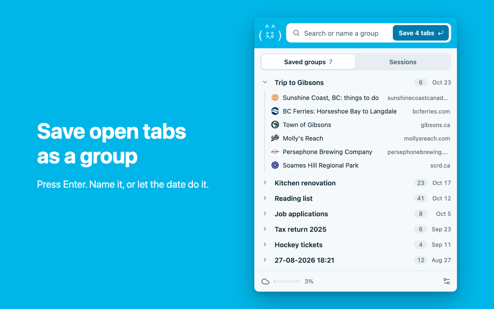
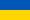

TabHamster browser extension
============================

Session manager and tab saver. With sync.
-----------------------------------------

Free, open source, no ads, no tracking.

Install for your browser:

**[Chrome Web Store](https://chromewebstore.google.com/detail/tabhamster/mkfjjmjmnplabnplceaekkjcmdddokee)**

**[Edge Add-ons](https://microsoftedge.microsoft.com/addons/detail/tabhamster/pifbgknmgjnlibbcbdblinmmlmdihkgc)**

Install it from the same store on every computer you sync: copies from the two stores keep separate groups (a backup
file moves groups between them). Brave, Vivaldi, Opera and other Chromium browsers can install it from the Chrome Web
Store.

Features
--------

- Press Enter to save the open tabs as a group. Type a name first, or leave it empty and the group is named by the date.
- Type to search group names, tab titles and addresses.
- Groups are kept in the browser's sync storage, so they show up on your other computers. Every group is also kept on
  your computer: hundreds of tabs per group, and a group is still saved when sync storage is full.
- Drag groups and tabs to reorder them, or drag a tab into another group. Edit and remove tabs, add a link or the
  current tab, replace a group with the open tabs.
- Sessions: everything that was open in your last 30 browser sessions, with closed tabs and windows and the pages each
  tab went through. Restore a session's windows as they were.
- Undo for changes and deletes. Deleted groups can be restored for 30 days.
- Back up groups and settings to a file, and restore them.
- Light and dark themes. Everything works with the keyboard and with screen readers.

Privacy
-------

TabHamster sends nothing to its author or anyone else. Groups go through the browser's own sync, sessions stay on your
computer. The one network request is optional and off until you allow it: "Load missing icons from sites" asks saved
sites for their `/favicon.ico`. Details in the
[privacy policy](https://onikienko.github.io/browser-extensions/tabhamster-privacy).

Translations
------------

English and Ukrainian are written by the author. Spanish, French, Hungarian and Serbian are machine translated: if you
speak one of them, corrections are welcome in `_locales/<language>/messages.json`.

Development
-----------

No dependencies and no build step to run it:

1. Open `chrome://extensions` (or `edge://extensions`), turn on Developer mode.
2. Load unpacked, and pick this folder.

Tests (Node 22 or newer): `node --test test/*.test.js test/*.test.mjs`

Store package: `cd build && python3 build.py -m` writes `build/releases/<version>.zip` (the version from
`manifest.json`) and adds that version to the top of [the changelog](build/releases/changelog.txt).

Contributing
------------

Issues and pull requests are welcome. By sending a pull request you agree that your contribution is licensed under
GPL-3.0 and that the owner of TabHamster, and anyone the project is transferred to, may also use it under other
licenses.

License
-------

Copyright (C) 2013-2026 Mykhailo Onikiienko

Licensed under the [GNU General Public License v3.0](LICENSE). The license covers the code, not the TabHamster name and
icon.

------------------------

### Glory to Ukraine 
